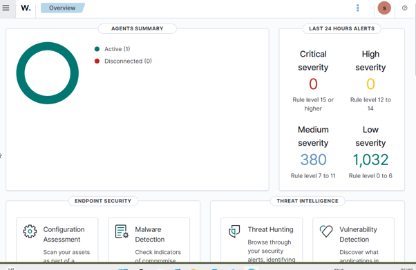
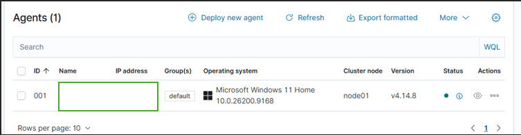
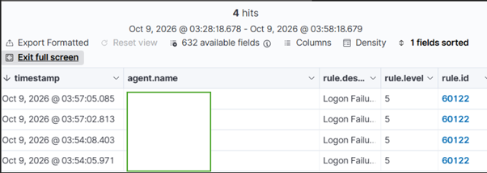
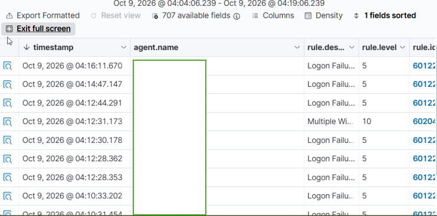
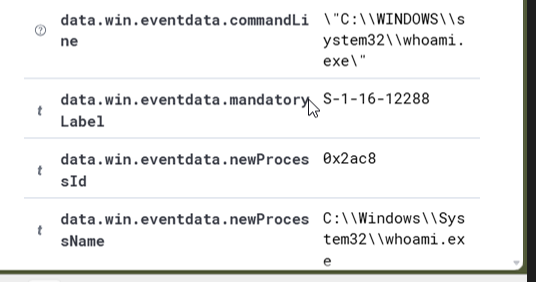

# Home SOC & Security Monitoring Lab

## Project Overview

This project demonstrates a beginner home Security Operations Centre (SOC) lab built with Wazuh, Windows 11 and Oracle VirtualBox. The aim was to practise collecting security events, investigating alerts and documenting findings using a SIEM platform.

## Lab Environment

- **SIEM:** Wazuh
- **Endpoint:** Windows 11 virtual machine
- **Virtualisation:** Oracle VirtualBox
- **Logging:** Windows Security Event Logging
- **Monitoring:** Wazuh agent and detection rules

## Investigations

### 1. Failed Windows Login

Generated a controlled failed login attempt and investigated Windows Event ID `4625` alongside Wazuh alert `60122`. Reviewed the alert details to understand how failed authentication activity is recorded.

### 2. Repeated Windows Login Failures

Generated repeated failed login attempts in the lab and investigated Wazuh rule `60204` (level 10). Reviewed the surrounding authentication activity and distinguished a known workstation unlock from evidence of an unauthorised login.

### 3. Windows Process Creation Monitoring

Enabled Windows process-creation auditing and command-line capture. Verified that Event ID `4688` events for processes including `whoami.exe`, `ipconfig.exe` and `tasklist.exe` could be collected in Wazuh.

## Skills Demonstrated

- SIEM monitoring and alert investigation
- Windows event log analysis
- Authentication-event triage
- Process-creation monitoring
- Basic incident assessment
- Evidence collection and technical documentation

## Key Learning

The project provided practical experience collecting Windows endpoint events and reviewing Wazuh alerts. It also reinforced the importance of investigating events in context rather than treating every alert as evidence of malicious activity.

## Future Improvements

- Develop additional detection and investigation scenarios.
- Explore further Windows logging sources where useful.
- Improve detection analysis and incident reporting.

## Disclaimer

All testing was conducted in a controlled home lab using systems under my control. This project is for educational and defensive cybersecurity purposes.

## Investigation Reports

The following reports document the objectives, procedures, findings and analyst assessments from each investigation.

1. [Investigation 01 — Failed Windows Login](investigations/01-failed-windows-login.md)
2. [Investigation 02 — Repeated Windows Login Failures](investigations/02-repeated-windows-login-failures.md)
3. [Investigation 03 — Windows Process Creation Monitoring](investigations/03-windows-process-monitoring.md)

## Evidence Gallery

The screenshots below provide visual evidence of the lab setup and investigations.

### Wazuh Overview

### Connected Windows Agent

### Investigation 01 — Failed Login

### Investigation 02 — Repeated Login Failures

### Investigation 03 — Process Monitoring

